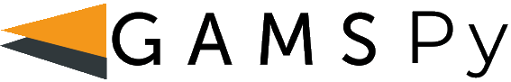

<p align="center">
  <picture>
    <source media="(prefers-color-scheme: dark)" srcset="https://github.com/GAMS-dev/gamspy/blob/develop/docs/_static/gamspy_logo_dark.png?raw=true">
    
  </picture>
</p>

<p align="center">
  <strong>Write optimization models in Python the way you write them on paper.</strong><br>
  Indexed algebra over sets, generated by the GAMS execution engine, solved by the solver of your choice.
</p>

<p align="center">
  <a href="https://pypi.org/project/gamspy/"></a>
  <a href="https://pepy.tech/project/gamspy"></a>
  <a href="https://pypi.org/project/gamspy/"></a>
  <a href="https://github.com/GAMS-dev/gamspy/blob/develop/LICENSE"></a>
  <a href="https://gamspy.readthedocs.io/en/latest/"></a>
  <a href="https://colab.research.google.com/github/GAMS-dev/gamspy/blob/develop/docs/user/notebooks/trnsport_colab.ipynb"></a>
</p>

<p align="center">
  
</p>

## Why GAMSPy

- **Models that read like math.** Declare variables and constraints over sets once (`storage[t] = level[t] == level[t - 1] + charge[t] - discharge[t]`) instead of building scalar expressions in Python loops.
- **Model generation outside Python.** GAMSPy hands the algebra to the GAMS execution engine, which has generated large industrial models for decades, so model size is not bound by Python loop speed.
- **Swap solvers without touching the model.** LP, MIP, NLP, MINLP, QCP and MCP models run on CPLEX, CONOPT, PATH and other bundled solvers, or on HiGHS, Gurobi, Knitro, Xpress, BARON, MOSEK and more with `gamspy install solver <name>`.
- **Fits your Python stack.** Load data from lists, NumPy arrays or pandas DataFrames and get results back as DataFrames.
- **Machine learning inside optimization.** Embed trained [PyTorch networks](https://gamspy.readthedocs.io/en/latest/user/ml/embed_nn.html) and [decision trees, random forests and gradient boosting](https://gamspy.readthedocs.io/en/latest/user/ml/classic_ml.html) as constraints.
- **Built-in formulations.** [Piecewise-linear functions, indicator and logical constraints](https://gamspy.readthedocs.io/en/latest/user/advanced/formulations.html), and [stochastic programming with SDDP](https://gamspy.readthedocs.io/en/latest/user/sddp/sddp.html) (beta).
- **Solve anywhere.** Run the same model locally, on [GAMS Engine or the NEOS Server](https://gamspy.readthedocs.io/en/latest/user/basics/model.html#solving-with-gams-engine), or turn it into an interactive [GAMS MIRO](https://gamspy.readthedocs.io/en/latest/user/advanced/miro.html) app.

## Installation

```sh
pip install gamspy
```

GAMSPy requires Python 3.11 or newer. The GAMS runtime, a set of default solvers and a demo license come with it, so the example below runs right after installation.

## Your first model

A 10 MW / 40 MWh battery buys electricity when it is cheap and sells it when it is expensive. Given tomorrow's hourly prices $p_t$, choose charging $c_t$ and discharging $d_t$ to maximize profit, while the stored energy $\ell_t$ follows a 95% efficiency each way:

$$
\begin{aligned}
\max \quad & \sum_{t} p_t \, (d_t - c_t) \\
\text{s.t.} \quad & \ell_t = \ell_{t-1} + 0.95\, c_t - d_t / 0.95 \quad \forall t \\
& 0 \le c_t,\ d_t \le 10, \quad 0 \le \ell_t \le 40 \quad \forall t
\end{aligned}
$$

In GAMSPy, the math maps line by line to code:

```python
import gamspy as gp
import numpy as np

night = [52, 48, 45, 44, 47, 58, 75, 82]
day = [61, 34, 12, -5, -8, 3, 21, 46]
evening = [78, 112, 135, 118, 92, 74, 63, 55]

m = gp.Container()

t = gp.Set(m, records=[f"{h:02}:00" for h in range(24)])
price = gp.Parameter(m, domain=t, records=np.array(night + day + evening))

charge = gp.Variable(m, domain=t, type="positive")
discharge = gp.Variable(m, domain=t, type="positive")
level = gp.Variable(m, domain=t, type="positive")
charge.up[t] = 10
discharge.up[t] = 10
level.up[t] = 40

storage = gp.Equation(m, domain=t)
storage[t] = level[t] == level[t - 1] + 0.95 * charge[t] - discharge[t] / 0.95

arbitrage = gp.Model(
    m,
    equations=[storage],
    problem="LP",
    sense="max",
    objective=gp.Sum(t, price[t] * (discharge[t] - charge[t])),
)
arbitrage.solve(solver="CPLEX")

bars = "".join("▁▂▃▄▅▆▇█"[round(v / 40 * 7)] for v in level.toDense())
print(f"Profit:  €{arbitrage.objective_value:,.0f}")
print(f"Battery: {bars}")
```

```text
Profit:  €5,016
Battery: ▁▃▅▆█▇▅▃▁▁▃▄▆████▆▄▂▁▁▁▁
```

The battery fills up overnight, sells into the morning peak, recharges while solar pushes midday prices below zero, and empties into the evening peak. To use another solver, change the name: `"HIGHS"`, `"IPOPT"` or any other installed solver solves the same model. `level[t - 1]` is the previous hour; before the first hour it is zero, so the battery starts empty. A year of hourly prices uses the same model: only the data changes.

Continue with the [quick start guide](https://gamspy.readthedocs.io/en/latest/user/notebooks/trnsport.html) or [run it in Colab](https://colab.research.google.com/github/GAMS-dev/gamspy/blob/develop/docs/user/notebooks/trnsport_colab.ipynb).

## Learn more

- [Documentation](https://gamspy.readthedocs.io/en/latest/)
- [Example notebooks](https://gamspy.readthedocs.io/en/latest/user/examples.html) and the [model library](https://github.com/GAMS-dev/gamspy-examples)
- [API reference](https://gamspy.readthedocs.io/en/latest/reference/index.html)
- Coming from GAMS? See [GAMSPy for GAMS users](https://gamspy.readthedocs.io/en/latest/user/gamspy_for_gams_users.html).

## License

The GAMSPy Python source is [MIT-licensed](https://github.com/GAMS-dev/gamspy/blob/develop/LICENSE). Solving uses the bundled GAMS runtime and solvers, which need a license:

- A **demo license** for small models is included.
- **Free licenses** are available for personal non-commercial use and for academic use (the academic one includes commercial solvers without size limits). Get one at the [GAMS Portal](https://portal.gams.com/); see [free licenses](https://www.gams.com/free-licenses/) for the terms.
- **Commercial and production use** needs a commercial license: contact [sales@gams.com](mailto:sales@gams.com).

See the [licensing guide](https://gamspy.readthedocs.io/en/latest/user/installation.html#licensing) for installation and exceptions.

## Community and contributing

Ask questions on the [GAMS Forum](https://forum.gams.com/), report bugs and request features in the [issue tracker](https://github.com/GAMS-dev/gamspy/issues), and see the [contributing guide](https://github.com/GAMS-dev/gamspy/blob/develop/CONTRIBUTING.md) to send changes.
