.. _formulations:

************
Formulations
************

.. meta::
   :description: GAMSPy User Guide
   :keywords: User, Guide, GAMSPy, gamspy, GAMS, gams, mathematical modeling, sparsity, performance, piecewise, linear, function

Formulations in GAMSPy provide an intuitive and user-friendly way to define
complex relations without delving deeply into the underlying mathematical
details. You can focus on what you want to achieve rather than how it is
implemented. For those interested in exploring the mechanics, GAMSPy also
provides full visibility into the underlying formulation. We've implemented a
variety of versatile formulations, including piecewise linear functions and
neural network construction blocks, empowering you to seamlessly integrate
advanced concepts into your optimization workflows.

Neural Network Related Formulations
-----------------------------------

GAMSPy supports following neural network related formulations:

- :meth:`Linear <gamspy.formulations.Linear>`
- :meth:`Conv1d <gamspy.formulations.Conv1d>`
- :meth:`Conv2d <gamspy.formulations.Conv2d>`
- :meth:`MaxPool2d <gamspy.formulations.MaxPool2d>`
- :meth:`MinPool2d <gamspy.formulations.MinPool2d>`
- :meth:`AvgPool2d <gamspy.formulations.AvgPool2d>`
- :meth:`RNN <gamspy.formulations.RNN>`
- :meth:`GRU <gamspy.formulations.GRU>`
- :meth:`flatten_dims <gamspy.formulations.flatten_dims>`

You can find more info at :ref:`nn-formulations`.

Piecewise Linear Functions
--------------------------

Piecewise linear functions are a cornerstone of practical optimization, as they
naturally arise in countless real-world scenarios. Whether modeling cost
structures, approximating nonlinear relationships, or defining breakpoints in
decision processes, their versatility and prevalence make them indispensable.
Recognizing this, we implemented robust support for piecewise linear
formulations in GAMSPy, enabling users to seamlessly incorporate these
essential tools into their models.

GAMSPy supports the following three formulations for implementing piecewise
linear functions:

- :meth:`pwl_interval_formulation <gamspy.formulations.pwl_interval_formulation>`
- :meth:`pwl_convexity_formulation <gamspy.formulations.pwl_convexity_formulation>`
- :meth:`pwl_dlog_formulation <gamspy.formulations.pwl_dlog_formulation>`

These formulation-specific functions accept separate x and y coordinates.
Alternatively, :class:`PWLCurve <gamspy.formulations.PWLCurve>` describes the
curve independently of a container, and
:meth:`pwlinear <gamspy.formulations.pwlinear>` selects one of the three
formulations when the curve is used.

Basic Usage
^^^^^^^^^^^

To define a piecewise linear function, specify the x and y coordinates of its
breakpoints. Consider the following graph:

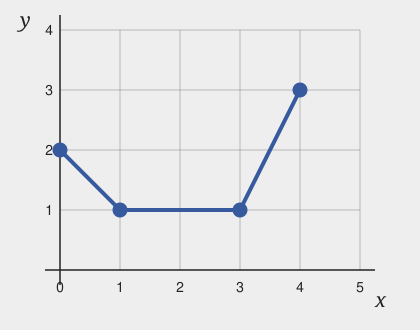

  A piecewise linear graph with four breakpoints.

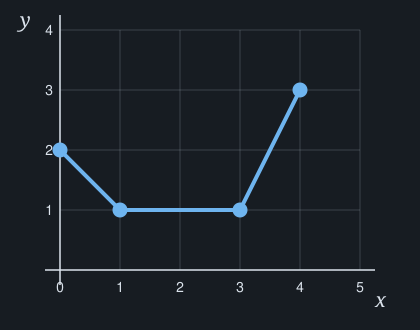

  A piecewise linear graph with four breakpoints.

The same graph can be modeled through any of the following interfaces:

.. tab-set::

   .. tab-item:: Interval formulation

      .. code-block:: python

         import gamspy as gp

         m = gp.Container()
         x = gp.Variable(m)
         y, eqs = gp.formulations.pwl_interval_formulation(
             x,
             x_points=[0, 1, 3, 4],
             y_points=[2, 1, 1, 3],
         )

   .. tab-item:: Convexity formulation

      .. code-block:: python

         import gamspy as gp

         m = gp.Container()
         x = gp.Variable(m)
         y, eqs = gp.formulations.pwl_convexity_formulation(
             x,
             x_points=[0, 1, 3, 4],
             y_points=[2, 1, 1, 3],
         )

   .. tab-item:: DLog formulation

      .. code-block:: python

         import gamspy as gp

         m = gp.Container()
         x = gp.Variable(m)
         y, eqs = gp.formulations.pwl_dlog_formulation(
             x,
             x_points=[0, 1, 3, 4],
             y_points=[2, 1, 1, 3],
         )

   .. tab-item:: Curve API

      .. code-block:: python

         import gamspy as gp

         m = gp.Container()
         x = gp.Variable(m)
         curve = gp.formulations.PWLCurve(
             [(0, 2), (1, 1), (3, 1), (4, 3)]
         )
         y, eqs = gp.formulations.pwlinear(x, curve, method="dlog")

The Curve API keeps the curve description separate from its formulation.
Changing ``method`` to ``"interval"``, ``"convexity"``, or ``"dlog"`` selects
the implementation without changing the points. All four interfaces return the
dependent variable ``y`` and a list of equations that must be included in the
model.

Representing Graph Structures
^^^^^^^^^^^^^^^^^^^^^^^^^^^^^

A piecewise linear graph can contain connected segments, unbounded rays,
excluded ranges, discontinuities, and overlapping chains. The following figure
summarizes these structures:

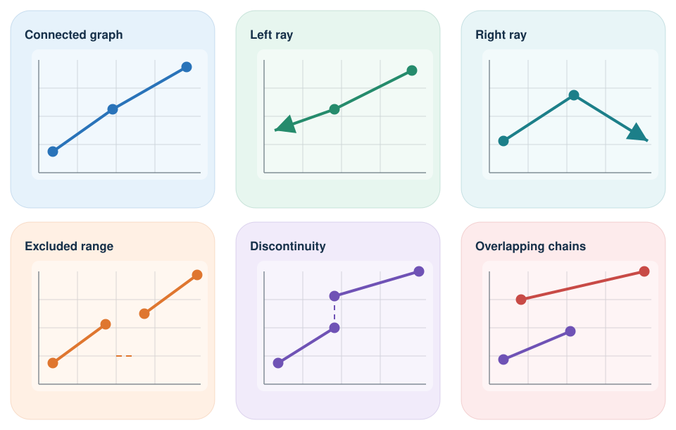

  Common piecewise linear graph structures supported by GAMSPy.

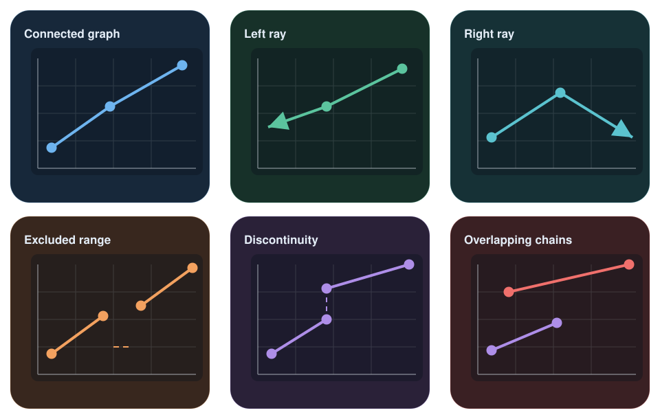

  Common piecewise linear graph structures supported by GAMSPy.

In a ``PWLCurve`` point stream, increasing x-coordinates continue a chain,
equal x-coordinates create a discontinuity, ``None`` disconnects two chains,
and a decrease in x starts a new independent chain. The same structures can be
represented with matching ``x_points`` and ``y_points``.

Connected Graphs
~~~~~~~~~~~~~~~~

An ordinary connected graph needs only increasing x-coordinates. For example,
``PWLCurve([(0, 0), (2, 4), (4, 6)])`` connects all three points. The equivalent
paired data is ``x_points=[0, 2, 4]`` and ``y_points=[0, 4, 6]``. Every
formulation supports this case.

Unbounded Rays
~~~~~~~~~~~~~~

A ray extends a graph beyond its first or last finite point. With the
formulation-specific functions, setting ``bound_left`` or ``bound_right`` to
``False`` extends the corresponding outer segment and uses that segment's
gradient:

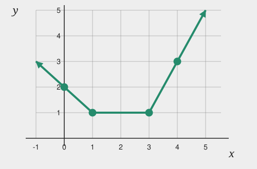

  A piecewise linear graph whose outer segments extend as rays.

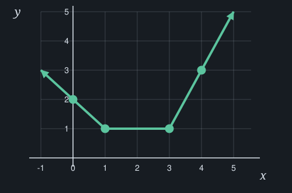

  A piecewise linear graph whose outer segments extend as rays.

.. code-block:: python

   import gamspy as gp

   m = gp.Container()
   x = gp.Variable(m)
   y, eqs = gp.formulations.pwl_interval_formulation(
       x,
       x_points=[0, 1, 3, 4],
       y_points=[2, 1, 1, 3],
       bound_left=False,
       bound_right=False,
   )

To choose gradients independently of the outer segments, define explicit rays.
The following two examples describe the same graph: the left ray has gradient
2, and the right ray has gradient -1.

.. tab-set::

   .. tab-item:: Curve API

      .. code-block:: python

         curve = gp.formulations.PWLCurve(
             [(0, 1), (2, 4), (4, 3)],
             left_gradient=-1,
             right_gradient=2,
         )
         y, eqs = gp.formulations.pwlinear(x, curve, method="dlog")

   .. tab-item:: Paired points

      .. code-block:: python

         import math

         y, eqs = gp.formulations.pwl_dlog_formulation(
             x,
             x_points=[-math.inf, 0, 2, 4, math.inf],
             y_points=[-1, 1, 4, 3, 2],
         )

For paired data, ``-math.inf`` and ``math.inf`` mark the left and right rays,
and the matching values in ``y_points`` are their gradients. ``PWLCurve`` uses
``left_gradient`` and ``right_gradient`` for the same purpose.

.. note::
    ``PWLCurve`` points and gradients must be finite. Define unbounded rays with
    ``left_gradient`` and ``right_gradient`` rather than infinity coordinates.

Excluded Ranges
~~~~~~~~~~~~~~~

Place ``None`` between two chains to exclude the range between their endpoints.
For example, the following graph allows ``x`` from 0 through 1.5 or from 2
through 4, but does not allow a value strictly between 1.5 and 2:

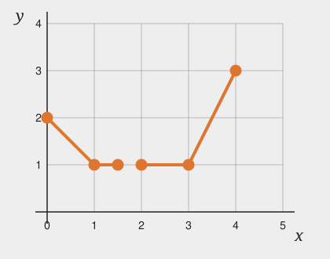

  A piecewise linear graph with no valid values between ``x = 1.5`` and
  ``x = 2``.

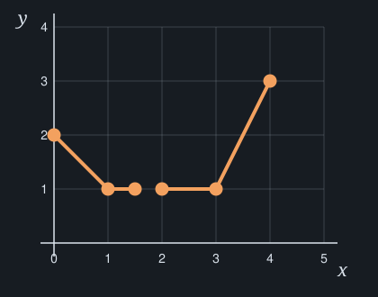

  A piecewise linear graph with no valid values between ``x = 1.5`` and
  ``x = 2``.

.. tab-set::

   .. tab-item:: Curve API

      .. code-block:: python

         curve = gp.formulations.PWLCurve(
             [
                 (0, 2),
                 (1, 1),
                 (1.5, 1),
                 None,
                 (2, 1),
                 (3, 1),
                 (4, 3),
             ]
         )
         y, eqs = gp.formulations.pwlinear(x, curve, method="interval")

   .. tab-item:: Paired points

      .. code-block:: python

         y, eqs = gp.formulations.pwl_interval_formulation(
             x,
             x_points=[0, 1, 1.5, None, 2, 3, 4],
             y_points=[2, 1, 1, None, 1, 1, 3],
         )

``None`` must occur in both paired sequences. It cannot appear first or last,
and two ``None`` values cannot be consecutive.

Advanced Multivalued Curves
^^^^^^^^^^^^^^^^^^^^^^^^^^^

Discontinuities and overlapping chains are multivalued: they can allow more
than one y-value for the same x-value.

.. important::
    Because this behavior may be unintentional, GAMSPy applies the safeguards
    described below when formulations are created from such curves.

Discontinuities
~~~~~~~~~~~~~~~

A repeated x-coordinate represents a discontinuity. In the example below,
``y`` can be either 1 or 2 when ``x`` is 3. The two points are endpoints of
different segments; the vertical line between them is not part of the graph.

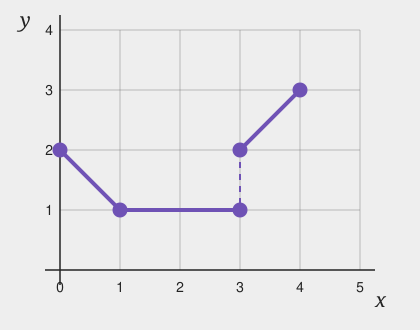

  A piecewise linear graph with a discontinuity at ``x = 3``.

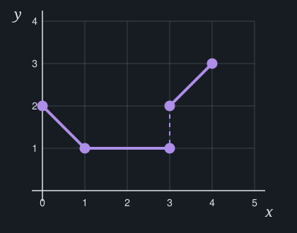

  A piecewise linear graph with a discontinuity at ``x = 3``.

By default, GAMSPy emits a warning for a point discontinuity but still builds
the formulation. Pass ``allow_multivalued=True`` to acknowledge the behavior
and suppress the warning. For the Curve API, this check occurs when
``pwlinear`` uses the curve, not when the ``PWLCurve`` object is created.

.. tab-set::

   .. tab-item:: Curve API

      .. code-block:: python

         curve = gp.formulations.PWLCurve(
             [(0, 2), (1, 1), (3, 1), (3, 2), (4, 3)]
         )
         y, eqs = gp.formulations.pwlinear(
             x,
             curve,
             method="dlog",
             allow_multivalued=True,
         )

   .. tab-item:: Paired points

      .. code-block:: python

         y, eqs = gp.formulations.pwl_dlog_formulation(
             x,
             x_points=[0, 1, 3, 3, 4],
             y_points=[2, 1, 1, 2, 3],
             allow_multivalued=True,
         )

Overlapping Chains
~~~~~~~~~~~~~~~~~~

A decrease in x starts a new independent chain. Here, the first chain covers
``x`` from 0 to 3 and the second covers ``x`` from 2 to 5, so the graph has two
valid y-values between 2 and 3:

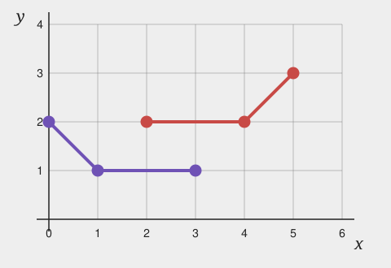

  Two independent chains provide two valid y-values between ``x = 2`` and
  ``x = 3``.

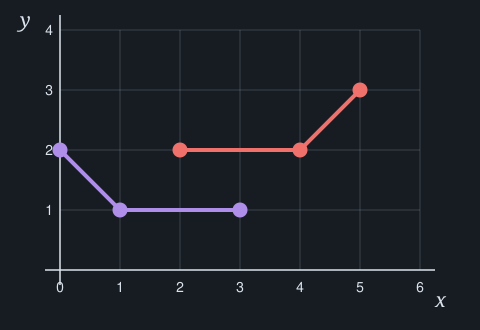

  Two independent chains provide two valid y-values between ``x = 2`` and
  ``x = 3``.

.. tab-set::

   .. tab-item:: Curve API

      .. code-block:: python

         curve = gp.formulations.PWLCurve(
             [(0, 2), (1, 1), (3, 1), (2, 2), (4, 2), (5, 3)]
         )
         y, eqs = gp.formulations.pwlinear(
             x,
             curve,
             method="dlog",
             allow_multivalued=True,
         )

   .. tab-item:: Paired points

      .. code-block:: python

         y, eqs = gp.formulations.pwl_dlog_formulation(
             x,
             x_points=[0, 1, 3, 2, 4, 5],
             y_points=[2, 1, 1, 2, 2, 3],
             allow_multivalued=True,
         )

Overlapping chains raise an error by default. Interval and DLog accept them
when ``allow_multivalued=True``. Convexity requires one non-decreasing SOS2
ordering and therefore rejects overlapping chains regardless of this argument.

Scalar, Broadcast, and Indexed Data
^^^^^^^^^^^^^^^^^^^^^^^^^^^^^^^^^^^

The formulation-specific functions accept ``x_points`` and ``y_points`` as
two sequences (Python lists or tuples), or as two matching
:class:`Parameters <gamspy.Parameter>`.
``pwlinear`` accepts one ``PWLCurve`` or, for an indexed input, a dictionary
whose keys are domain labels and values are curves for that domain label.

.. note::
    ``x_points`` and ``y_points`` must both be sequences or both be Parameters;
    the two forms cannot be mixed. To define row-specific curves, use indexed
    Parameters or a dictionary of ``PWLCurve`` objects instead.

    Indexed ``input_x`` variables must use non-empty explicit Set or Alias
    domains. Wildcard and ``UniverseAlias`` domains are rejected before
    formulation symbols are created.

Curve domains must retain their order in ``input_x.domain``. For example, if
the input domains are ``[scenario, product, year]``, then ``[product]`` and
``[scenario, year]`` are valid curve domains, while ``[year, scenario]`` is not.

.. list-table::
   :header-rows: 1
   :widths: 32 24 44

   * - Input data
     - ``input_x``
     - Behavior
   * - Two sequences or one-dimensional Parameters
     - Scalar
     - Define one graph
   * - Two sequences or one-dimensional Parameters
     - Indexed
     - Define one graph that is broadcast to every row
   * - Parameters over an ordered subset of input domains and a breakpoint domain
     - Indexed
     - Define curves by the selected domains and broadcast over omitted domains
   * - One ``PWLCurve``
     - Scalar or indexed
     - Define one graph, broadcast when the input is indexed
   * - Dictionary of domain labels and ``PWLCurve`` values
     - Indexed
     - Define curves by ``curve_domain`` and broadcast over omitted domains

Broadcast Data
~~~~~~~~~~~~~~

Sequences define one graph. When ``input_x`` is indexed, GAMSPy broadcasts that
graph to every domain entry:

.. tab-set::

   .. tab-item:: Sequences

      .. code-block:: python

         m = gp.Container()
         product = gp.Set(m, records=["basic", "premium"])
         x = gp.Variable(m, domain=product)
         y, eqs = gp.formulations.pwl_interval_formulation(
             x,
             x_points=[0, 2, 4],
             y_points=[1, 5, 9],
         )

   .. tab-item:: Parameters

      .. code-block:: python

         m = gp.Container()
         product = gp.Set(m, records=["basic", "premium"])
         breakpoint = gp.Set(m, records=["p0", "p1", "p2"])
         x = gp.Variable(m, domain=product)
         x_points = gp.Parameter(
             m,
             domain=breakpoint,
             records=[("p0", 0), ("p1", 2), ("p2", 4)],
         )
         y_points = gp.Parameter(
             m,
             domain=breakpoint,
             records=[("p0", 1), ("p1", 5), ("p2", 9)],
         )
         y, eqs = gp.formulations.pwl_interval_formulation(
             x, x_points, y_points
         )

Both examples apply the same graph to ``basic`` and ``premium``.

Indexed Parameter Data
~~~~~~~~~~~~~~~~~~~~~~

Parameters can define curves over any ordered subset of the ``input_x``
domains. The selected domains are followed by one breakpoint domain, and each
curve is broadcast over the omitted input domains. Using every input domain
defines a different curve for every row. All three formulation-specific
functions support this behavior. Matching internal
``gp.SpecialValues.NA`` values disconnect chains, like matching ``None`` values
in sequences. Matching trailing ``NA`` values pad rows that use fewer
breakpoints:

.. note::
    ``x_points`` and ``y_points`` must belong to the same container as
    ``input_x`` and have identical domains.

.. code-block:: python

   import numpy as np

   m = gp.Container()
   scenario = gp.Set(m, records=["low", "high"])
   product = gp.Set(m, records=["basic", "premium"])
   breakpoint = gp.Set(m, records=["p0", "p1", "p2", "p3", "p4"])
   x = gp.Variable(m, domain=[scenario, product])
   na = gp.SpecialValues.NA

   x_points = gp.Parameter(
       m,
       domain=[product, breakpoint],
       records=np.array(
           [[0, 2, na, 4, 6], [0, 3, 5, na, na]]
       ),
   )
   y_points = gp.Parameter(
       m,
       domain=[product, breakpoint],
       records=np.array(
           [[0, 4, na, 8, 12], [1, 7, 9, na, na]]
       ),
   )
   y, eqs = gp.formulations.pwl_dlog_formulation(
       x, x_points, y_points
   )

Here, ``basic`` has an excluded range between 2 and 4, while ``premium`` uses
three breakpoints and two trailing padding positions. The product curves are
reused for both scenarios because ``scenario`` is omitted from the Parameter
domains. Both kinds of ``NA`` must occur at the same positions in the two
Parameters.

Indexed Curve Dictionaries
~~~~~~~~~~~~~~~~~~~~~~~~~~

For ``pwlinear``, ``curve_domain`` declares which input domains are represented
by the dictionary keys. The curves are broadcast over omitted domains:

.. code-block:: python

   m = gp.Container()
   scenario = gp.Set(m, records=["low", "high"])
   product = gp.Set(m, records=["basic", "premium"])
   x = gp.Variable(m, domain=[scenario, product])
   curves = {
       "basic": gp.formulations.PWLCurve([(0, 0), (2, 4)]),
       "premium": gp.formulations.PWLCurve([(0, 0), (1, 3), (2, 5)]),
   }
   y, eqs = gp.formulations.pwlinear(
       x,
       curves,
       curve_domain=[product],
       method="interval",
   )

This applies each product curve to both scenarios. For a one-dimensional
``curve_domain``, dictionary keys are labels such as ``"basic"``. Multiple
curve domains use tuples in the declared order. If ``curve_domain`` is omitted,
it defaults to all ``input_x`` domains; a full two-dimensional dictionary then
uses keys such as ``("low", "basic")``.

.. note::
    Curve dictionaries require explicit domain Sets and must contain exactly
    one curve for every label combination in ``curve_domain``. Missing or extra
    keys and wildcard domains are rejected.

Passing one curve instead of a dictionary broadcasts it to every row:

.. code-block:: python

   shared_curve = gp.formulations.PWLCurve([(0, 0), (2, 4)])
   y, eqs = gp.formulations.pwlinear(x, shared_curve)

Choosing a Formulation
^^^^^^^^^^^^^^^^^^^^^^

.. list-table::
   :header-rows: 1
   :widths: 18 30 22 30

   * - Formulation
     - Representation
     - Discrete variables
     - Suitable graphs
   * - Interval
     - One position and one selector for each finite segment
     - Approximately one binary variable per selectable unit
     - All supported graph features, including overlapping chains
   * - Convexity
     - One shared weight per breakpoint with SOS2 adjacency
     - Native SOS2 or a logarithmic binary encoding, plus ray gating
     - Graphs with one non-decreasing SOS2 ordering
   * - DLog
     - Two endpoint weights for each finite segment
     - ``ceil(log2(k))`` address bits for ``k`` selectable units, plus ray gating
     - All supported graph features, including overlapping chains

With ``pwlinear``, ``method`` defaults to ``"interval"`` and can also be set to
``"convexity"`` or ``"dlog"``. Convexity uses its binary implementation by
default; pass ``using="sos2"`` to use native SOS2 variables instead. With
Interval or DLog, an explicit ``using`` value is ignored and produces a
warning. The formulation-specific Convexity function provides the same choice
through its ``using`` argument.

The relative performance of Interval, Convexity, and DLog depends on the
surrounding model, graph structure, and solver. Although DLog generally uses
fewer binary variables as the number of selectable segments grows, a smaller
binary-variable count does not necessarily translate into shorter solve times.
We encourage GAMSPy users to benchmark the supported formulations with their
intended solvers on representative problem instances and share the results on
the `GAMSPy Forum <https://forum.gams.com/c/gamspy/10>`_. We would be delighted
to learn from your experience.

For a complete application, see the
`transportation model with PWL formulations <https://github.com/GAMS-dev/gamspy-examples/blob/master/models/trnspwl/trnspwl_formulations.py>`_.
It applies the Convexity and Interval APIs to three versions of the same
piecewise-linear approximation and shows the equivalent Curve API calls.

API Reference
^^^^^^^^^^^^^

For complete argument and return-value details, refer to:

- :meth:`pwl_interval_formulation <gamspy.formulations.pwl_interval_formulation>`
- :meth:`pwl_convexity_formulation <gamspy.formulations.pwl_convexity_formulation>`
- :meth:`pwl_dlog_formulation <gamspy.formulations.pwl_dlog_formulation>`
- :class:`PWLCurve <gamspy.formulations.PWLCurve>`
- :meth:`pwlinear <gamspy.formulations.pwlinear>`

Indicator Constraints
---------------------

Many models need logical relations such as "if a facility is closed, nothing
can be shipped from it". :meth:`indicator <gamspy.formulations.indicator>`
makes such relations available for mixed-integer problems in a solver independent way. Some solvers support this natively (restrictions to the type of constraint may apply) for others this is reformulated using SOS1 or bigM constructs.

An indicator constraint ``indicator(b, value, constraint)`` enforces
``constraint`` whenever the binary variable ``b`` equals ``value`` and drops
it otherwise. The following example forbids shipments from closed plants. The
binary variable ``is_open`` is defined over ``i`` and controls the constraint
for every ``j``:

.. code-block:: python

   import gamspy as gp

   m = gp.Container()
   i = gp.Set(m, "i", records=["seattle", "san-diego"])
   j = gp.Set(m, "j", records=["new-york", "chicago", "topeka"])
   ship = gp.Variable(m, "ship", type="positive", domain=[i, j])
   is_open = gp.Variable(m, "is_open", type="binary", domain=i)

   # is_open[i] == 0  =>  ship[i, j] <= 0
   _, eqs = gp.formulations.indicator(is_open, 0, ship[i, j] <= 0)

The domain of the binary variable must be a subset of the domain of the
constraint. The constraint can be an inequality or an equality.

By default, the indicator constraint is modeled with SOS1 variables. This
formulation does not need any bounds, but requires a solver that supports SOS1
variables, such as COPT, CPLEX, GUROBI, SCIP, and XPRESS. Some solvers, e.g. BARON, HiGHS and
MOSEK, do not support SOS1 variables. In that case, or if a big-M formulation
performs better for your model, pass ``big_m``:

.. code-block:: python

   _, eqs = gp.formulations.indicator(is_open, 0, ship[i, j] <= 0, big_m=1000)

``big_m`` must be at least as large as the largest possible violation of the
constraint while it is dropped, i.e. the largest value of ``lhs - rhs`` for a
``<=`` constraint. Here, this is the largest possible shipment. A value that is
too small cuts off feasible solutions and silently returns wrong results. A
valid value that is smaller leads to a tighter relaxation and usually to faster
solves. Besides a number, ``big_m`` can be a parameter or an expression of
parameters and variable bounds, which lets each constraint have its own
value:

.. code-block:: python

   capacity = gp.Parameter(
       m, "capacity", domain=i, records=[("seattle", 350), ("san-diego", 600)]
   )
   _, eqs = gp.formulations.indicator(
       is_open, 0, ship[i, j] <= 0, big_m=capacity[i]
   )

   # use the bounds of the variable, which must be finite
   ship.up[i, j] = capacity[i]
   _, eqs = gp.formulations.indicator(
       is_open, 0, ship[i, j] <= 0, big_m=ship.up[i, j]
   )

To enforce the constraint only for some elements of its domain, add a
condition with ``.where``. The formulation then generates equations only where
the condition holds:

.. code-block:: python

   min_ship = gp.Parameter(
       m, "min_ship", domain=j, records=[("new-york", 50), ("topeka", 20)]
   )

   # is_open[i] == 1  =>  ship[i, j] >= min_ship[j], only where min_ship[j] > 0
   _, eqs = gp.formulations.indicator(
       is_open, 1, (ship[i, j] >= min_ship[j]).where[min_ship[j] > 0]
   )

Alternatively, index the constraint with a multidimensional subset. The
generated symbols are then limited to the elements of the subset:

.. code-block:: python

   routes = gp.Set(
       m,
       "routes",
       domain=[i, j],
       records=[("seattle", "chicago"), ("san-diego", "topeka")],
   )
   use = gp.Variable(m, "use", type="binary", domain=[i, j])

   # use[routes] == 0  =>  ship[routes] <= 0
   _, eqs = gp.formulations.indicator(use[routes], 0, ship[routes] <= 0)

Some solvers handle *linear* indicator constraints directly in their branch-and-cut
algorithm instead of relying on a reformulation. Pass ``native=True`` to keep
the constraint as it is and let :meth:`solve <gamspy.Model.solve>` hand the
indicator relation directly to the solver. Native indicator
constraints are supported by COPT, CPLEX, GUROBI, SCIP and XPRESS. Solving the
model with any other solver raises an error:

.. code-block:: python

   _, eqs = gp.formulations.indicator(is_open, 0, ship[i, j] <= 0, native=True)

Reformulating Indicator Constraints
^^^^^^^^^^^^^^^^^^^^^^^^^^^^^^^^^^^

An indicator constraint either holds or is ignored, depending on a binary
variable. The following figure shows the feasible points of
:math:`b = 1 \implies x \leq 2` for :math:`0 \leq x \leq 5`. They form two
separate segments, one for each value of :math:`b`.

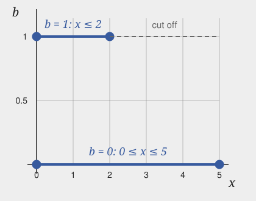

  Feasible points of :math:`b = 1 \implies x \leq 2`. The constraint cuts off
  the dashed part only if :math:`b = 1`.

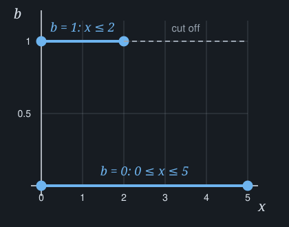

  Feasible points of :math:`b = 1 \implies x \leq 2`. The constraint cuts off
  the dashed part only if :math:`b = 1`.

To describe all cases at once, each formulation writes the constraint as
:math:`g \leq 0`, where :math:`g = lhs - rhs` for a ``<=`` constraint and
:math:`g = rhs - lhs` for a ``>=`` constraint. An equality is split into both
inequalities. Similarly, let :math:`a` be the activation, which equals 1 when
the constraint must hold, i.e. :math:`a = b` if ``value`` is 1 and
:math:`a = 1 - b` if it is 0. The formulation then models:

.. math::

   a = 1 \implies g \leq 0

**SOS1 (default).** The constraint gets a nonnegative slack :math:`s` that
forms an SOS1 set with the activation, i.e. at most one of them is nonzero:

.. math::

   g \leq s

   \{a, s\} \in \text{SOS1}, \quad s \geq 0

If :math:`a = 1`, then :math:`s = 0`, so :math:`g \leq 0`. If :math:`a = 0`,
:math:`s` can take any value and the constraint is dropped. No bounds are
needed, but the solver enforces the SOS1 set only by branching. Its LP
relaxation drops the SOS1 set, so :math:`s` is unbounded and the relaxation
does not restrict :math:`x` at all, even for :math:`b = 1`. An equality uses
one slack for both inequalities, i.e. :math:`|lhs - rhs| \leq s`. Since
:math:`a` can be the expression :math:`1 - b`, and a binary variable cannot
be part of an SOS1 set, the implementation stores a copy of :math:`a`
together with :math:`s` in one SOS1 variable, stored under ``sos1``, and
links the copy to :math:`a` with the ``link`` equation. The other equations
are stored under ``slack`` (``le_slack`` and ``ge_slack`` for an equality).

**Big-M.** With ``big_m``, the constraint becomes one inequality, stored
under ``big_m`` (``le_big_m`` and ``ge_big_m`` for an equality):

.. math::

   g \leq M (1 - a)

If :math:`a = 1`, the right-hand side is 0, so :math:`g \leq 0`. If
:math:`a = 0`, the inequality must not cut off any feasible point, so
:math:`M` must be at least the largest value of :math:`g`. In the shipping
example above, :math:`a = 1 - is\_open_i` and :math:`g = ship_{ij}`, which
gives the well-known constraint:

.. math::

   ship_{ij} \leq M \cdot is\_open_i \quad \forall{i, j}

For a fractional :math:`a`, the right-hand side interpolates between the two
cases. Therefore, unlike the SOS1 formulation, the LP relaxation restricts
:math:`x`, and a smaller :math:`M` restricts it more. In the example of the
figure, :math:`g = x - 2` is at most 3, so :math:`M = 3` is the smallest
valid value. Then the relaxation is :math:`x \leq 2 + 3 (1 - b)`, which is
the convex hull of the feasible points. :math:`M = 6` is also valid but cuts
off less:

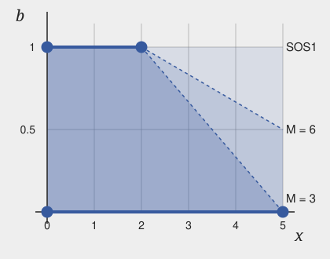

  LP relaxations of the SOS1 and big-M formulations of :math:`b = 1 \implies
  x \leq 2` for :math:`0 \leq x \leq 5`. The SOS1 relaxation is the whole
  box, and the big-M relaxations are bounded by the dashed lines.

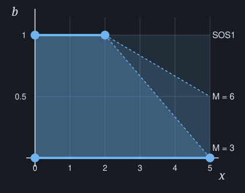

  LP relaxations of the SOS1 and big-M formulations of :math:`b = 1 \implies
  x \leq 2` for :math:`0 \leq x \leq 5`. The SOS1 relaxation is the whole
  box, and the big-M relaxations are bounded by the dashed lines.

**Native.** With ``native=True``, the constraint is not reformulated. It is
stored under ``indicator`` and passed to the solver as an indicator
constraint. The solver decides how to enforce it. A redundant constraint :math:`\sum b \geq 0`, stored under
``binary``, ensures that the binary variable is part of the model.

If the binary variable has fewer dimensions than the constraint, the same
binary variable controls the constraint for all elements of the other
dimensions, e.g. :math:`is\_open_i` for all :math:`j` above. If the
constraint has a condition or is indexed with a subset, the equations exist
only for the corresponding elements.

Minimum, Maximum and Absolute Value
-----------------------------------

Many models contain quantities that are the largest or the smallest of several
values: the peak load over all time periods, the completion time of the last
job, or the price of a contract that pays the better of a fixed and a market
price. Writing these with :meth:`Max <gamspy.math.Max>` or
:meth:`Min <gamspy.math.Min>` makes the model a ``DNLP``. These functions are
not differentiable where the operands are equal, so NLP solvers can struggle
with them and do not guarantee a global optimum. With binary variables, the
same relation can be expressed exactly with linear constraints.

Do You Need a Formulation?
^^^^^^^^^^^^^^^^^^^^^^^^^^

Often you do not. If the model only ever benefits from making a maximum
smaller, or a minimum larger, plain inequalities are enough and the model
does not need discrete helper variables. For example, a power plant must be built large enough for the
peak demand, and minimizing the capacity cost keeps ``capacity`` at the peak:

.. code-block:: python

   import gamspy as gp

   m = gp.Container()
   t = gp.Set(m, "t", records=["morning", "noon", "evening"])
   load = gp.Variable(m, "load", domain=t)
   capacity = gp.Variable(m, "capacity")

   # capacity >= max(load[t] for t)
   peak = gp.Equation(m, "peak", domain=t)
   peak[t] = capacity >= load[t]

The inequalities only state that ``capacity`` is at least the maximum, i.e.
they allow every point above the maximum, as the following figure shows for
two operands :math:`a_1` and :math:`a_2` that depend on a variable :math:`x`.
The objective takes care of the rest, because a larger ``capacity`` costs
more. This works when you minimize a maximum or maximize a minimum.

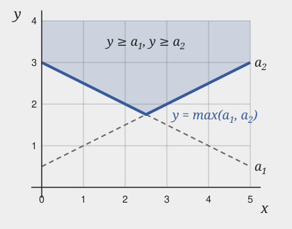

  The inequalities :math:`y \geq a_k` allow every point in the shaded region;
  the maximum is only its lower boundary.

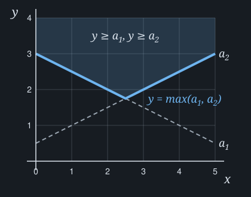

  The inequalities :math:`y \geq a_k` allow every point in the shaded region;
  the maximum is only its lower boundary.

The inequalities are not enough when the model benefits from moving the value
away from the true maximum or minimum. Then the solver simply does so. Suppose
a farmer sells under a contract that pays the better of a fixed price and
the market price, and the model maximizes income. With ``income >= ...``
constraints alone, the solver raises ``income`` without limit. The same
happens when you maximize a maximum or minimize a minimum, or when the value
feeds other constraints in a way that makes it attractive to move. In these
cases, use :meth:`maximum <gamspy.formulations.maximum>` or
:meth:`minimum <gamspy.formulations.minimum>`, which make the result equal
to the maximum or minimum:

.. code-block:: python

   i = gp.Set(m, "i", records=["wheat", "corn"])
   contract_price = gp.Parameter(
       m, "contract_price", domain=i, records=[("wheat", 200), ("corn", 150)]
   )
   market_price = gp.Parameter(
       m, "market_price", domain=i, records=[("wheat", 180), ("corn", 170)]
   )
   sold = gp.Variable(m, "sold", type="positive", domain=i)

   # income[i] == max(contract_price[i] * sold[i], market_price[i] * sold[i])
   income, eqs = gp.formulations.maximum(
       contract_price[i] * sold[i], market_price[i] * sold[i]
   )

Unlike ``capacity`` above, you do not declare ``income`` yourself.
:meth:`maximum <gamspy.formulations.maximum>` creates the variable, together
with the equations that make it equal to the maximum, and returns both. The
variable gets a generated name that starts with ``output_var_``, so refer to
it through the returned object. Operands can be numbers,
parameters, variables or expressions. The domain of the result is the union
of the operand domains, ``i`` in this example. If an operand is indexed with a multidimensional subset, such as
``x[ij]`` with ``ij(i, j)``, the result is declared over ``i`` and ``j`` but
only constrained for the elements of ``ij``. Use it as ``result[ij]``, since
its other elements are free.

To take the maximum or minimum over a set instead of over separate operands,
pass the set with ``over``:

.. code-block:: python

   # highest_load == max(load[t] for t)
   highest_load, eqs = gp.formulations.maximum(load, over=t)

Absolute Value
^^^^^^^^^^^^^^

An absolute value is the maximum of a value and its negation, so the same
reasoning applies. Writing it with :meth:`abs <gamspy.math.abs>` makes the
model a ``DNLP``. When the model benefits from a small absolute value, e.g.
when you minimize the deviation from a target, two inequalities are enough:

.. code-block:: python

   target = gp.Parameter(m, "target", domain=t, records=[("noon", 80)])
   deviation = gp.Variable(m, "deviation", domain=t)

   # deviation[t] >= abs(load[t] - target[t])
   above = gp.Equation(m, "above", domain=t)
   above[t] = deviation[t] >= load[t] - target[t]
   below = gp.Equation(m, "below", domain=t)
   below[t] = deviation[t] >= target[t] - load[t]

When the model benefits from a large absolute value, or the value must be
exact, use :meth:`absolute <gamspy.formulations.absolute>`:

.. code-block:: python

   # exact_deviation[t] == abs(load[t] - target[t])
   exact_deviation, eqs = gp.formulations.absolute(load[t] - target[t])

For complete applications, see the
`express delivery fleet purchase <https://github.com/GAMS-dev/gamspy-examples/blob/master/models/fleetspeed/fleetspeed.py>`_
for :meth:`maximum <gamspy.formulations.maximum>`, the
`transportation problem with chartered trucks <https://github.com/GAMS-dev/gamspy-examples/blob/master/models/trnscharter/trnscharter.py>`_
for :meth:`minimum <gamspy.formulations.minimum>` and the
`single row facility layout problem <https://github.com/GAMS-dev/gamspy-examples/blob/master/models/srflp/srflp.py>`_
for :meth:`absolute <gamspy.formulations.absolute>`.

How It Works
^^^^^^^^^^^^

Let :math:`a_1, \dots, a_n` be the operands and :math:`y = \max(a_1, \dots,
a_n)`. :meth:`maximum <gamspy.formulations.maximum>` introduces a binary
variable :math:`b_k` for every operand and generates:

.. math::

   y \geq a_k \quad \forall{k}

   b_k = 1 \implies y \leq a_k \quad \forall{k}

   \sum_{k}{b_k} = 1

   b_k \in \{0, 1\} \quad \forall{k}

The first constraints are the inequalities from `Do You Need a Formulation?`_
and keep :math:`y` above every operand. The binary variables select one
operand, and the indicator constraints pull :math:`y` down to the selected
operand. The formulation is exact:

- Every feasible :math:`y` is the maximum. The first constraints give
  :math:`y \geq \max_k a_k`. If :math:`b_j = 1`, the indicator constraint
  gives :math:`y \leq a_j \leq \max_k a_k`.
- Every maximum is feasible. Select an operand :math:`j` with :math:`a_j =
  \max_k a_k`, i.e. set :math:`b_j = 1` and the other binary variables to 0.
  If several operands attain the maximum, any of them can be selected.

The following figure shows the feasible points for the two operands of the
first figure. Selecting :math:`b_1 = 1` forces :math:`y = a_1`, and
:math:`y \geq a_2` then requires :math:`a_1 \geq a_2`. Therefore, each binary
variable selects one piece of the maximum, and only the pieces together give
the whole maximum. The union of the pieces is not convex, which is why no LP
can describe the maximum exactly and the binary variables are needed:

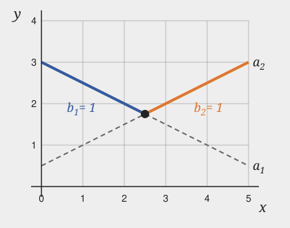

  Each binary variable selects the piece of the maximum where its operand is
  the largest. Both are feasible where the operands are equal.

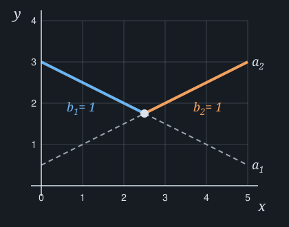

  Each binary variable selects the piece of the maximum where its operand is
  the largest. Both are feasible where the operands are equal.

The generated symbols are available in the returned
:class:`FormulationResult <gamspy.formulations.FormulationResult>`
under the following keys, where ``k`` is the position of the operand:

=========================================  ================================
Symbol                                     Key
=========================================  ================================
:math:`y \geq a_k`                         ``bound_k``
:math:`b_k = 1 \implies y \leq a_k`        see `Reformulating the Selection`_
:math:`\sum_{k}{b_k} = 1`                  ``pick_one``
:math:`y`                                  ``output``
:math:`b_k`                                ``select_k``
=========================================  ================================

With ``over``, the selection also ranges over the elements of the given sets.
Each operand gets binary variables over its own domain, and ``pick_one``
selects exactly one of them for each element of the domain of :math:`y`. For
example, ``maximum(x[i, j], z[i], over=j)`` generates the following, where
:math:`b_{ij}` is stored under ``select_0`` and :math:`c_i` under
``select_1``:

.. math::

   y_i \geq x_{ij} \quad \forall{i, j}

   y_i \geq z_i \quad \forall{i}

   b_{ij} = 1 \implies y_i \leq x_{ij} \quad \forall{i, j}

   c_i = 1 \implies y_i \leq z_i \quad \forall{i}

   \sum_{j}{b_{ij}} + c_i = 1 \quad \forall{i}

:meth:`minimum <gamspy.formulations.minimum>` reverses the inequalities, i.e.
it generates :math:`y \leq a_k` and :math:`b_k = 1 \implies y \geq a_k`.
:meth:`absolute <gamspy.formulations.absolute>` generates the maximum of
:math:`a` and :math:`-a`:

.. math::

   y \geq a, \quad y \geq -a

   b_1 = 1 \implies y \leq a

   b_2 = 1 \implies y \leq -a

   b_1 + b_2 = 1

Together with :math:`y \geq -a`, selecting :math:`b_1 = 1` requires
:math:`a \geq 0`. Therefore, the binary variables also encode the sign of
:math:`a`. Both are feasible if :math:`a = 0`.

Reformulating the Selection
^^^^^^^^^^^^^^^^^^^^^^^^^^^

The indicator constraints :math:`b_k = 1 \implies y \leq a_k` are modeled with
:meth:`indicator <gamspy.formulations.indicator>`. Therefore, the formulation
accepts the same ``big_m`` and ``native`` arguments and the advice in
`Indicator Constraints`_ applies. The generated symbols of each indicator
constraint are suffixed with ``_k``.

**SOS1 (default).** Each indicator constraint gets an SOS1 set as described
in `Reformulating Indicator Constraints`_, stored under ``slack_k``,
``link_k`` and ``sos1_k``. No bounds are needed, but the LP relaxation drops
the SOS1 sets and keeps only :math:`y \geq a_k`, i.e. the shaded region of
the first figure.

**Big-M.** With ``big_m``, each indicator constraint becomes one inequality,
stored under ``big_m_k``:

.. math::

   y - a_k \leq M (1 - b_k) \quad \forall{k}

If :math:`b_k = 1`, the right-hand side is 0. If :math:`b_k = 0`, the
constraint must not cut off any feasible point, so :math:`M` must be at least
the largest value of :math:`y - a_k`. Since :math:`y` is at most the largest
upper bound :math:`U` of the operands and :math:`a_k` is at least the
smallest lower bound :math:`L`, :math:`M = U - L` is valid. For
:meth:`absolute <gamspy.formulations.absolute>` with :math:`|a| \leq A`, this
gives :math:`M = 2A`. A value that is too small silently cuts off solutions.
``big_m`` can also be a parameter expression, which gives each element of the
domain its own value.

Unlike the SOS1 sets, the big-M constraints bound :math:`y` from above in the
LP relaxation, and the bound is tighter for a smaller :math:`M`. For the two
operands of the figures, adding both constraints and using :math:`b_1 + b_2 =
1` gives :math:`2y \leq a_1 + a_2 + M`. The operands are between 0.5 and 3,
so :math:`M = U - L = 2.5` is valid. It is also the smallest valid value,
since the gap :math:`y - a_1` reaches 2.5 at :math:`x = 0`. Then the
relaxation is
:math:`y \leq 3`, which is the convex hull of the maximum. A larger
:math:`M = 3.5` relaxes it to :math:`y \leq 3.5`:

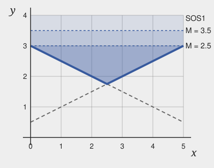

  LP relaxations of the SOS1 and big-M formulations for :math:`0 \leq x \leq
  5`. The SOS1 relaxation is unbounded above, and the big-M relaxations are
  bounded by the dashed lines.

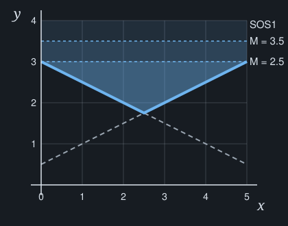

  LP relaxations of the SOS1 and big-M formulations for :math:`0 \leq x \leq
  5`. The SOS1 relaxation is unbounded above, and the big-M relaxations are
  bounded by the dashed lines.

**Native.** With ``native=True``, the indicator constraints are passed to the
solver as they are, stored under ``indicator_k``. The solver decides how to
enforce them. As in `Reformulating Indicator Constraints`_, a redundant
constraint per operand is stored under ``binary_k``.

For each element of the domain of :math:`y` and :math:`n` selectable operands,
i.e. operands times the elements of ``over``, the formulation generates the
following symbols in addition to :math:`y`:

=========  ================  ===============  =================
Mode       Binary variables  SOS1 sets        Equations
=========  ================  ===============  =================
SOS1       :math:`n`         :math:`n`        :math:`3n + 1`
Big-M      :math:`n`         0                :math:`2n + 1`
Native     :math:`n`         0                :math:`2n + 1`
=========  ================  ===============  =================

The native mode also adds the ``binary_k`` constraints, one per operand. To
choose a mode:

- Use the default if the operands have no finite bounds, or if you do not know
  them. It requires a solver that supports SOS1 variables.
- Use ``big_m`` if the operands have tight bounds. The stronger relaxation
  usually pays off, and every MIP solver supports it.
- Use ``native=True`` with a solver that supports indicator constraints to
  let the solver choose how to handle them.

Every operand adds a binary variable, so prefer the plain inequalities
whenever they are enough.

Logical Constraints
-------------------

Binary variables often stand for yes/no decisions, and models need to combine
them: a machine runs if *any* product is assigned to it, a route is usable if
*both* of its end points are open, or a facility needs a permit if it is
*not* outsourced. :meth:`logical_and <gamspy.formulations.logical_and>`,
:meth:`logical_or <gamspy.formulations.logical_or>`,
:meth:`logical_not <gamspy.formulations.logical_not>`,
:meth:`logical_xor <gamspy.formulations.logical_xor>`,
:meth:`logical_imp <gamspy.formulations.logical_imp>` and
:meth:`logical_eqv <gamspy.formulations.logical_eqv>` create a binary variable
that equals the AND, OR, NOT, exclusive disjunction, implication or
equivalence of binary variables, using only linear constraints.
The functions :meth:`bool_and <gamspy.math.bool_and>`,
:meth:`bool_xor <gamspy.math.bool_xor>` etc. are meant for data. Applied to
variables, they make the model nonlinear, and it no longer compiles as a
``MIP``.

Do You Need a Logical Formulation?
^^^^^^^^^^^^^^^^^^^^^^^^^^^^^^^^^^

As with `Minimum, Maximum and Absolute Value`_, often you do not. If the
model only ever benefits from setting the result to 0, the constraints that
force it to 1 are enough. The classic example is a fixed cost that is paid if
any product is assigned to a machine. Minimizing the cost keeps ``runs`` at
0 unless an assignment forces it to 1:

.. code-block:: python

   import gamspy as gp

   m = gp.Container()
   p = gp.Set(m, "p", records=["bolts", "nuts", "screws"])
   k = gp.Set(m, "k", records=["lathe", "press"])
   assign = gp.Variable(m, "assign", type="binary", domain=[p, k])
   runs = gp.Variable(m, "runs", type="binary", domain=k)

   # runs[k] >= assign[p, k] for every p, i.e. runs[k] >= OR(assign[p, k] for p)
   setup = gp.Equation(m, "setup", domain=[p, k])
   setup[p, k] = runs[k] >= assign[p, k]

Similarly, if the model only benefits from setting the result to 1, e.g. a
bonus that is paid if a route is usable, ``usable <= open[a]`` and
``usable <= open[b]`` are enough for an AND.

You also do not need a formulation if the logical expression must simply
hold, rather than be available as a variable. Each of the following is a
single linear constraint on binary variables ``a`` and ``b``:

=====================================  ==================
Must hold                              Constraint
=====================================  ==================
``a`` implies ``b``                    ``a <= b``
``a`` is equivalent to ``b``           ``a == b``
exactly one of ``a`` and ``b``         ``a + b == 1``
at least one of ``a`` and ``b``        ``a + b >= 1``
both ``a`` and ``b``                   fix both to 1
=====================================  ==================

The one-sided constraints are not enough when the model benefits from moving
the result in the other direction, for example when ``runs`` is rewarded
elsewhere, or when it controls an :meth:`indicator
<gamspy.formulations.indicator>` constraint that holds for both of its
values. Then the solver sets the result to whatever value suits it. In these
cases, use the formulations, which make the result equal to the logical
expression:

.. code-block:: python

   # runs[k] == OR(assign[p, k] for p)
   runs, eqs = gp.formulations.logical_or(assign, over=p)

   # idle[k] == NOT runs[k]
   idle, eqs = gp.formulations.logical_not(runs)

   is_open = gp.Variable(m, "is_open", type="binary", domain=k)

   # ready[k] == is_open[k] AND idle[k]
   ready, eqs = gp.formulations.logical_and(is_open, idle)

   ran_before = gp.Variable(m, "ran_before", type="binary", domain=k)

   # switched[k] == runs[k] XOR ran_before[k], e.g. to charge a switching cost
   switched, eqs = gp.formulations.logical_xor(runs, ran_before)

Like :meth:`maximum <gamspy.formulations.maximum>`, each formulation creates
the result variable, with a generated name that starts with ``output_var_``,
and returns it together with its equations. Add the equations to the model,
including those of intermediate results such as ``idle`` above, otherwise the
intermediate variable is free. The result is a binary variable, so it can be
an operand of another logical formulation or the binary variable of an
indicator constraint.

The operands must be binary variables. To negate an operand, pass the result
of :meth:`logical_not <gamspy.formulations.logical_not>`. The domain of the
result is the union of the operand domains. For ``logical_and`` and
``logical_or``, ``over`` combines the operands over the given sets, as for
:meth:`maximum <gamspy.formulations.maximum>`. ``logical_xor``, ``logical_imp`` and ``logical_eqv`` 
take exactly two operands. If an operand is indexed with a multidimensional subset,
the result is only constrained for the elements of the subset.

For complete applications, see the
`product portfolio with synergies <https://github.com/GAMS-dev/gamspy-examples/blob/master/models/prodsyn/prodsyn.py>`_
for :meth:`logical_and <gamspy.formulations.logical_and>`, the
`corn and soybean rotation planning <https://github.com/GAMS-dev/gamspy-examples/blob/master/models/croprot/croprot.py>`_
for :meth:`logical_xor <gamspy.formulations.logical_xor>` and the
`nurse rostering with weekend and supervision rules <https://github.com/GAMS-dev/gamspy-examples/blob/master/models/nurseroster/nurseroster.py>`_
for the other logical formulations.

How Logical Formulations Work
^^^^^^^^^^^^^^^^^^^^^^^^^^^^^

Let :math:`b_1, \dots, b_n` be the binary operands. With ``over``, every
element of the given sets counts as a separate operand. :meth:`logical_and
<gamspy.formulations.logical_and>` generates:

.. math::

   y \leq b_k \quad \forall{k}

   y \geq 1 - \sum_{k}{(1 - b_k)}

If some :math:`b_k = 0`, the first constraints force :math:`y = 0`. If all
:math:`b_k = 1`, the sum is 0 and the last constraint forces :math:`y = 1`.
:meth:`logical_or <gamspy.formulations.logical_or>` generates:

.. math::

   y \geq b_k \quad \forall{k}

   y \leq \sum_{k}{b_k}

If some :math:`b_k = 1`, the first constraints force :math:`y = 1`. If all
:math:`b_k = 0`, the last constraint forces :math:`y = 0`. Over an empty set,
the AND is 1 and the OR is 0, like :meth:`Sand <gamspy.Sand>` and
:meth:`Sor <gamspy.Sor>`. The first constraints are the one-sided
constraints of `Do You Need a Logical Formulation?`_, and the last
constraint adds the other direction. :meth:`logical_not
<gamspy.formulations.logical_not>` generates :math:`y = 1 - b`.

For two operands :math:`a` and :math:`b`, the truth table has four rows. The
formulations of :meth:`logical_xor <gamspy.formulations.logical_xor>`,
:meth:`logical_imp <gamspy.formulations.logical_imp>` and
:meth:`logical_eqv <gamspy.formulations.logical_eqv>` rule out the wrong value
of :math:`y` in every row:

.. math::

   \text{xor:} \quad y \geq a - b, \quad y \geq b - a, \quad
   y \leq a + b, \quad y \leq 2 - a - b

   \text{imp:} \quad y \geq 1 - a, \quad y \geq b, \quad
   y \leq 1 - a + b

   \text{eqv:} \quad y \geq a + b - 1, \quad y \geq 1 - a - b, \quad
   y \leq 1 - a + b, \quad y \leq 1 + a - b

Each inequality rules out the wrong value in one or two rows and allows the
right value in all of them. For example, at :math:`a = b = 1`, the other XOR
constraints allow both values of :math:`y`, and :math:`y \leq 2 - a - b`
forces :math:`y = 0`. At the other rows, it allows :math:`y = 1`. The
implication needs only three inequalities, because :math:`y \geq 1 - a`
covers both rows with :math:`a = 0`.

No big-M value or bounds are needed for any of the formulations, and the LP
relaxation is exact: for fractional operands, the constraints describe the
convex hull of the truth table, so the solver never has to branch on
:math:`y`. Each formulation adds one binary variable per element of the
domain of :math:`y`, and :math:`n + 1` equations for AND and OR, one for NOT,
three for the implication, and four for XOR and the equivalence.

The generated symbols are available in the returned
:class:`FormulationResult <gamspy.formulations.FormulationResult>` under the
following keys, where ``k`` is the position of the operand for AND and OR,
and the position of the inequality in the order above otherwise:

=================================  ================  ==============
Symbol                             Formulation       Key
=================================  ================  ==============
:math:`y \leq b_k`                 ``logical_and``   ``upper_k``
:math:`y \geq 1 - \sum (1 - b_k)`  ``logical_and``   ``lower_0``
:math:`y \geq b_k`                 ``logical_or``    ``lower_k``
:math:`y \leq \sum b_k`            ``logical_or``    ``upper_0``
:math:`y = 1 - b`                  ``logical_not``   ``complement``
``k``-th :math:`y \geq \dots`      xor, imp and eqv  ``lower_k``
``k``-th :math:`y \leq \dots`      xor, imp and eqv  ``upper_k``
:math:`y`                          all               ``output``
=================================  ================  ==============
